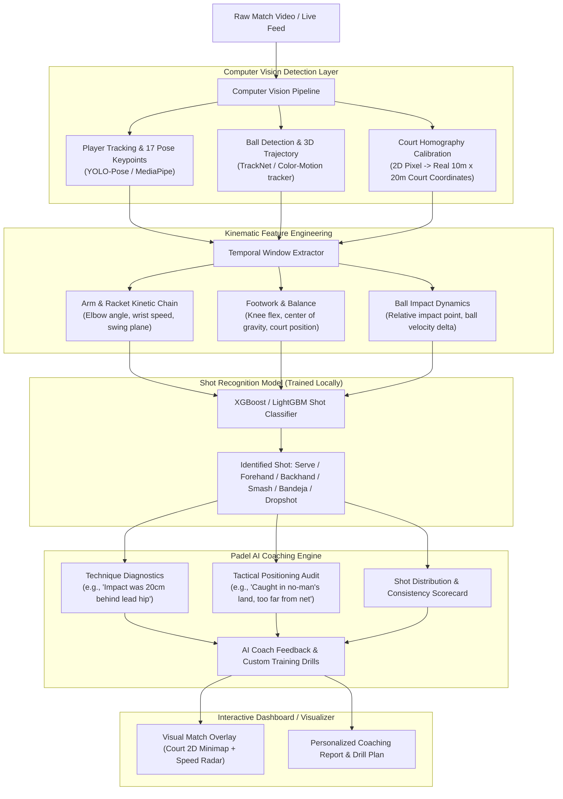

# Padel AI Computer Vision Coach: Hardware Resource Analysis & System Architecture

## 1. Laptop Hardware Audit & Resource Usage Verdict

### Your Current System Specifications
* **CPU:** Intel Core i5-6200U @ 2.30 GHz (2 Cores, 4 Threads)
* **GPU:** Intel HD Graphics 520 (Integrated graphics, shared memory, **No dedicated NVIDIA CUDA GPU**)
* **RAM:** 8.0 GB DDR3/DDR4
* **Available Disk Space:** ~78 GB Free (C: Drive)
* **OS:** Windows (64-bit)
* **Python:** 3.12.10 (Installed libraries include Scikit-learn, XGBoost, LightGBM, Pandas, NumPy, FastAPI)

---

### Will Training The Model Use Many Resources On This Laptop?

The short answer is **it depends on *which* layer of the model you train**, but here is the exact breakdown:

| Model Training Component | Will It Heavily Strain This Laptop? | CPU / RAM / Heat Impact | Recommended Platform |
| :--- | :--- | :--- | :--- |
| **Deep Learning Vision Models** *(e.g., Training YOLOv8/v11 for ball/players, TrackNet, Video 3D CNNs)* | **YES, EXTREMELY.** Do **NOT** train these locally. | • CPU pegged at 100% continuously for days. • High temperatures & thermal throttling. • 8 GB RAM will easily trigger Out-Of-Memory (OOM) crashes. • Training that takes 30 mins on a GPU takes 48–120 hours on this dual-core CPU. | **Free Cloud GPU** (Google Colab T4 / Kaggle 30 hrs/week free GPU) |
| **Biomechanics & Shot Classifier** *(XGBoost, Random Forest, or LightGBM on extracted 17 pose keypoints + ball coordinates)* | **NO, ALMOST NONE.** Perfect to run locally! | • Takes **15 to 60 seconds** to train. • Uses **< 600 MB RAM**. • Laptop stays cool and responsive. | **This Laptop (Local CPU)** |
| **AI Coach Rule & Biomechanics Engine** *(Shot speed, elbow/wrist angle, court positioning, drill recommendation heuristics)* | **NO, MINIMAL.** Runs effortlessly. | • Pure algorithmic math & logic. • Uses < 200 MB RAM and negligible CPU. | **This Laptop (Local CPU)** |
| **Local Inference / Running The System** *(Processing a match video using pre-trained ONNX/OpenVINO models)* | **MODERATE.** Feasible with optimization. | • 60–80% CPU usage. • Runs at ~5–12 FPS offline (video processing). • Does not crash if batched properly. | **This Laptop (CPU with OpenVINO / ONNX Quantization)** |

> [!IMPORTANT]
> **Key Takeaway:** You do **NOT** need to fry your laptop to build this AI Coach! The rich dataset you already have in `c:\Padel\labels` (`*_pose.json`, `*_ball.json`, `*_shots.csv`) already contains pre-extracted player poses and ball trajectories. You can train the **Shot Classification Model** and **AI Coaching Engine** locally in under 1 minute. If you ever need to train heavy computer vision neural networks on raw video frames, use **Google Colab or Kaggle (100% Free T4 GPUs)**.

---

## 2. Padel Dataset Overview (What You Already Have)

Your workspace contains the official **PadelTracker100** benchmark data:
1. **Video Matches:**
   * `2022_BCN_FinalF_1.mp4` (~2.9 GB) & `2022_BCN_FinalF_1_sample.mp4` (Women's Final)
   * `2022_BCN_FinalM_1.mp4` (~4.2 GB) (Men's Final)
2. **Ground Truth Annotations (`c:\Padel\labels\`):**
   * **`*_pose.json`**: 17 COCO keypoints per player (nose, eyes, shoulders, elbows, wrists, hips, knees, ankles) + player bounding boxes for every single frame.
   * **`*_ball.json`**: Ball detection bounding boxes, wall bounces, and event tags.
   * **`*_shots.csv`**: Ground-truth shot classification per frame:
     - `Serve`
     - `Forehand`
     - `Backhand`
     - `Smash`
     - `Dropshot`
     - `Other`
     - `0` (rally / non-shot movement)

---

## 3. End-to-End System Architecture: Padel AI Coach

---

## 4. Detailed Component Breakdown

### A. Detection & Tracking Module
* **Player Pose (17 Keypoints):** Identifies player stance, knee flexion, torso rotation, and arm extension.
* **Ball Tracking:** Computes trajectory curve, speed (km/h), apex, bounce points, and glass rebounds.
* **Court Calibration:** Maps the camera perspective to a normalized 2D bird's-eye view (10m x 20m padel court), allowing exact tracking of court positioning (Baseline, Transition Zone, Net/Kitchen).

### B. Action & Shot Recognition Model
* **Input:** A temporal window of 15–30 frames around a candidate shot event.
* **Features:**
  * Wrist angular velocity and racket acceleration
  * Height of contact point relative to head/shoulder/hip
  * Shoulder-to-hip rotation angle
  * Ball trajectory slope before and after contact
* **Model Type:** Gradient-Boosted Decision Trees (XGBoost / LightGBM) or 1D Temporal Convolutional Network.
* **Output:** Shot category with confidence score (e.g., `Smash: 94%`, `Bandeja: 88%`).

### C. The AI Coaching Intelligence Engine
The bot acts as a certified coach by evaluating 3 pillars:

1. **Biomechanical Form & Technique:**
   * **Smash / Bandeja:** Did the player jump with proper shoulder alignment? Was contact made at maximum reach?
   * **Forehand / Backhand:** Did the player prepare early? Was contact in front of the body? Did the knees bend during low balls off the glass?
2. **Tactical & Court Positioning:**
   * Player pairing sync (are both partners moving together as a unit?).
   * Net control efficiency vs. baseline retreat frequency.
   * Recovery time after defending off the back glass.
3. **Prescriptive Action Plan & Drills:**
   * Generates tailored drills based on error frequency (e.g., *"3 out of 5 backhands missed due to late preparation; Drill: 20 rapid feed wall-rebound backhands"*).

### D. Interactive UI / Dashboard
* **Video Player with Overlays:** Ball trail, skeleton visualization, speed indicators.
* **2D Minimap (Bird's Eye):** Real-time player movement and ball heatmaps.
* **Coach Chatbot & Stats Summary:** Accuracy percentages, top smash speed, unforced errors, and drill suggestions.

---

## 5. Optimal Workflow & Next Steps

To build this without overloading your laptop:

1. **Phase 1 (Immediate - Local):**
   * Parse the existing `2022_BCN_Final*_pose.json`, `*_ball.json`, and `*_shots.csv`.
   * Extract kinematic features into a structured tabular dataset.
   * Train the **XGBoost Shot Classifier** locally (runs in seconds).
2. **Phase 2 (Immediate - Local):**
   * Implement the **Padel AI Coach Rule & Biomechanics Engine** (computes shot speed, form critique, and tactical advice).
3. **Phase 3 (Immediate - Local):**
   * Build a lightweight interactive demonstration (annotating sample video clips or generating a web dashboard with player statistics and coaching feedback).
4. **Phase 4 (Optional - Cloud GPU):**
   * If new unannotated videos need custom detector training, run the script on Google Colab / Kaggle with free T4 GPU, export the lightweight ONNX weights, and bring them back to this laptop for inference.
